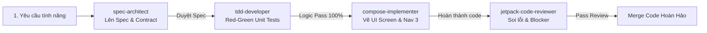

# AGENTS.md — Shine Android Project Guidelines

Tài liệu này cung cấp toàn bộ hướng dẫn, quy chuẩn kiến trúc, công nghệ và các quy tắc phát triển dành cho các AI Agent và Developer khi làm việc trên dự án **Shine**.

---

## 1. Tổng quan Dự án (Project Overview)

- **Tên dự án:** Shine
- **Nền tảng:** Android (Native)
- **Package name:** `com.example.shine`
- **Mục tiêu:** Ứng dụng điều phối công việc, giao tiếp doanh nghiệp (Workspace, Channels, Direct Messages, Project/Planix Management, Profile).
- **API Server:** `https://employer-api.dev.hodfords.uk/`

---

## 2. Công nghệ & Thư viện Chính (Tech Stack)

| Thành phần | Công nghệ / Thư viện | Phiên bản / Ghi chú |
| :--- | :--- | :--- |
| **Language & SDK** | Kotlin, Java 17 | Kotlin `2.4.20`, compileSdk/targetSdk `37`, minSdk `26` |
| **Build System** | Gradle Version Catalogs (`libs.versions.toml`), AGP | AGP `9.4.1`, KSP `2.3.12` |
| **UI Framework** | Jetpack Compose + Material 3 | Compose BOM `2026.09.00` |
| **Navigation** | **AndroidX Navigation 3** (mới nhất) | `androidx.navigation3:navigation3-runtime:1.2.0`, `navigation3-ui` |
| **Dependency Injection** | Dagger Hilt | `hilt-android:2.60.1`, Hilt Navigation Compose |
| **Networking** | Retrofit 3 + OkHttp 5 | `retrofit:3.0.0`, `okhttp:5.5.0`, Kotlinx Serialization Json |
| **Local Storage** | Room Database + DataStore Preferences | Room `2.8.5`, DataStore `1.2.1` |
| **Paging** | AndroidX Paging 3 | Paging Compose `3.3.6`, `RemoteMediator`, `PagingSource` |
| **Image Loading** | Coil Compose | `io.coil-kt:coil-compose:2.7.0` |
| **Testing** | JUnit 4, Kotlinx Coroutines Test, Turbine, Mockito, MockWebServer, Paging Testing | Hỗ trợ Unit Test toàn diện cho ViewModel & Data layers |

---

## 3. Cấu trúc Thư mục (Project Structure)

Dự án đang áp dụng **Multi-module Architecture (theo chuẩn Google Now in Android)** kết hợp **Clean Architecture** & UDF:

```
Shine/
├── core/
│   ├── model/                     # Pure data models (Channel, DirectMessage, User, Workspace, Project, Session, SyncStatus, SignInStatus)
│   ├── common/                    # Core utilities, Dispatchers, NetworkMonitor, AppLifecycleMonitor, AppException, UiText
│   ├── database/                  # Room Database (ShineDatabase), Entities, DAOs, DatabaseModule
│   ├── datastore/                 # DataStore Preferences (Session, Tokens, Workspace), DataStoreModule
│   ├── network/                   # Retrofit APIs, DTOs & Mappers, OkHttp Interceptors, Socket.IO engine, NetworkModule
│   ├── data/                      # Repository (interfaces & impls), Paging (PlanixRemoteMediator), Sync (Worker & Scheduler), DataModule
│   ├── domain/                    # Use Cases (SignOutUseCase), Domain Interactors & Coordinators, DomainModule
│   └── designsystem/              # Design system, Theme, Components, Icons
├── feature/
│   ├── auth/                      # Authentication (SignIn)
│   ├── camera/                    # Camera capture & Media preview
│   ├── channel/                   # Channels list, creation & details
│   ├── dm/                        # Direct messages list & details
│   ├── home/                      # Dashboard container, drawer, settings
│   ├── planix/                    # Planix / Project management
│   ├── profile/                   # User profile & avatar update
│   └── workspace/                 # Workspace selection & management
└── app/
    ├── src/main/java/com/example/shine/
    │   ├── ShineApplication.kt    # Application class, @HiltAndroidApp
    │   ├── MainActivity.kt        # Single Activity, Compose & Deep Links
    │   ├── core/                  # App-level di (ShortcutModule, WidgetSyncListenerModule) & shortcuts
    │   ├── ui/                    # Root navigation & app scaffold
    │   └── widget/                # Glance AppWidget & sync managers
```

---

## 4. Quy tắc Thiết kế & Kiến trúc (Architectural Guidelines)

### 4.1. Modern Android Architecture & Unidirectional Data Flow (UDF)
- **Tầng Data (:core:data):** Đóng vai trò là *Single Source of Truth* cho toàn bộ ứng dụng. Cung cấp các Repository interfaces (Public API) cho các tầng UI/Feature tiêu thụ, và đóng gói chi tiết triển khai (Room, Network, DataStore, Paging 3, Sync Worker).
- **Tầng UI:** 
  - Chỉ quan sát trạng thái qua `StateFlow<UiState>` từ `ViewModel`.
  - Mọi sự kiện từ người dùng (User Actions) gửi tới ViewModel thông qua các public method.
  - Sử dụng Stateless Composable cho UI rendering và Stateful Composable (Route) để liên kết ViewModel.

### 4.2. Quản lý Điều hướng (Jetpack Navigation 3)
> [!IMPORTANT]
> Dự án sử dụng **Jetpack Navigation 3** (không dùng NavHostController / Navigation 2 XML / chuỗi String route cũ).

- **Khai báo NavKey:** Đặt trong `ui/navigation/NavKeys.kt` của module `:app`, kế thừa `androidx.navigation3.runtime.NavKey` và có annotation `@Serializable`.
  ```kotlin
  @Serializable
  data object Home : NavKey

  @Serializable
  data class ChannelDetail(val channelId: String) : NavKey
  ```
- **Quản lý BackStack:** Sử dụng `rememberNavBackStack(...)`, `NavDisplay(...)`, phối hợp với decorators:
  - `rememberSaveableStateHolderNavEntryDecorator()`
  - `rememberViewModelStoreNavEntryDecorator()`
  - `rememberResultEventBusNavEntryDecorator()`
- **Quản lý luồng xác thực và Khởi tạo ViewModel:** Trong `ShineApp.kt`, ứng dụng sử dụng một `NavDisplay` duy nhất kết hợp `LaunchedEffect(authState)` để tự động điều hướng và làm sạch `backStack` giữa các trạng thái `Unauthenticated` (SignIn), `SelectWorkspace`, và `Authenticated` (Home). Tầng `:app` đóng vai trò **Orchestrator** duy nhất:
  - Giữ toàn bộ `entryProvider { ... }`.
  - Khởi tạo `hiltViewModel()` trực tiếp ngay tại từng `entry<Key> { ... }` rồi truyền vào `Route(viewModel = viewModel, ...)`. Điều này bảo đảm ViewModel được gắn chính xác vào vòng đời của từng `NavEntry` và giải phóng tự động khi entry được pop khỏi backstack.
  - Các feature module hoàn toàn tinh gọn: chỉ cung cấp `Stateless Screen` và `Stateful Route(viewModel)`, không phải bọc thêm các entry provider hay phụ thuộc vào logic điều hướng của app.
- **Kiến trúc DeepLink (Chuẩn AndroidX Navigation 3):**
  - Sử dụng `UriDeepLinkMatcher` / `AppDeepLinkMatcher` và `BackStackMatcher<*, NavKey>`.
  - Đăng ký matcher độc lập qua Dagger Hilt Multibindings `@IntoSet` trong `DeepLinkModule`.
  - Tự động dựng synthetic back stack với `.withBackStack { matchResult -> listOf(Home, matchResult.key) }`.
  - Điều phối tập trung qua `AppDeepLinkHandler` (hỗ trợ cả Web URL lẫn App Shortcuts via Intent Extras).
  - `AppNavigator.setBackStack(...)` phối hợp với `AuthState.Authenticated` để đảm bảo Auth Guard trước khi hiển thị màn hình đích.

### 4.3. Quản lý Phiên (Session) & Xác thực
- **SessionLocalDataSource:** Quản lý `Session` (Token, RefreshToken, User, WorkspaceId) lưu trữ bảo mật trong DataStore.
- **SessionProvider (:core:datastore):** In-memory cache (`StateFlow<Session?>`) cung cấp token và workspaceId đồng bộ tức thì cho `AuthInterceptor` mà không block disk I/O.
- **SessionManager (:core:data):** Quản lý vòng đời phiên toàn ứng dụng trên `ApplicationScope`. Lắng nghe sự thay đổi của session, tự động dọn dẹp tập trung toàn bộ Room Database (`ShineDatabase.clearAll()`), in-memory database, cache DMs và WorkManager sync tasks khi phiên bị hủy (Sign out hoặc 401 token refresh fail).
- **Tự động làm mới Token:** 
  - `AuthInterceptor` thêm header `Authorization: Bearer <token>` vào request.
  - `TokenRefreshScheduler` / `TokenRefresher` quản lý chu kỳ làm mới token trước khi hết hạn. Khi refresh thất bại, `TokenRefresher` chỉ cần xóa session và để `SessionManager` tự động kích hoạt dọn dẹp.

### 4.4. Xử lý Lỗi (Error Handling)
- **Tập trung hóa AppException:** Tất cả lỗi mạng, máy chủ và không có Internet đều được chuyển đổi thành `AppException(val error: AppError, val serverMessage: String? = null)`.
- **ErrorMappingCallAdapterFactory:** Retrofit CallAdapter tự động bọc response lỗi HTTP và IO thành `AppException`.
- **Hiển thị thông báo trên UI:** Sử dụng `UiText` (hỗ trợ cả String tĩnh lẫn String Resource ID) hoặc gán thông điệp lỗi vào `errorMessage` của `UiState`.

### 4.5. Paging 3 & Caching
- Danh sách lớn (ví dụ: Planix list) sử dụng Room kết hợp **Paging 3** (`RemoteMediator` hoặc `PagingSource`) để hỗ trợ load phân trang vô tận và cache offline.

---

## 5. Quy chuẩn Viết Code & Phong cách (Coding Conventions)

1. **Immutability:**
   - UI State phải luôn là `data class` với các thuộc tính `val`.
   - Cập nhật state bằng `_uiState.update { current -> current.copy(...) }`.
2. **Dependency Injection:**
   - Sử dụng Hilt: Thêm `@HiltViewModel` cho tất cả ViewModels, inject repository thông qua interface thay vì class implementation cụ thể.
   - Dispatchers cho Coroutines cần được inject thông qua `@IoDispatcher`, `@DefaultDispatcher` từ `CoroutinesModule` để thuận tiện viết Unit Test.
3. **Coroutines & Scopes:**
   - Trong ViewModel, chỉ launch coroutines trong `viewModelScope`.
   - Thu thập Flow trên UI Compose bằng `collectAsStateWithLifecycle()`.
4. **Bảo tồn Comment & Tài liệu:** Giữ nguyên các comment giải thích nghiệp vụ quan trọng trong code hiện có.

---

## 6. Quy tắc Kiểm thử (Testing Standards)

> [!IMPORTANT]
> Dự án duy trì độ phủ Unit Test rất cao. Mọi tính năng mới hoặc thay đổi logic trong ViewModel, Repository, DataSource, Interceptor đều **bắt buộc** phải có Unit Test đi kèm trong `app/src/test`.

### 6.1. Quy chuẩn Unit Test cho ViewModel
- Sử dụng **Fake Repository Pattern** từ module `:core:testing` (`com.example.shine.core.testing.repository.Fake*Repository`) thay vì duplicate code fake cục bộ hoặc lạm dụng mockito nếu không cần thiết.
- Tự động quản lý Coroutine Test Dispatcher bằng `MainDispatcherRule` (`com.example.shine.core.testing.rules.MainDispatcherRule`) thay cho việc viết `@Before`/`@After` thủ công:
  ```kotlin
  @get:Rule
  val mainDispatcherRule = MainDispatcherRule()
  ```
- Kích hoạt thu thập StateFlow trong background scope hoặc sử dụng **Turbine** (`app.cash.turbine.test`) để kiểm tra toàn bộ chuỗi emission theo thời gian:
  ```kotlin
  // Khuyến nghị dùng Turbine cho StateFlow / Cold Flow
  viewModel.uiState.test {
      val item = awaitItem()
      assertEquals(expected, item)
      cancelAndIgnoreRemainingEvents()
  }
  ```

### 6.2. Kiểm thử Tầng Dữ liệu (Data Layer Testing)
- Sử dụng `MockWebServer` để kiểm tra Retrofit APIs, Interceptors, và CallAdapters.
- Sử dụng In-Memory Database (`Room.inMemoryDatabaseBuilder`) hoặc Mock DAO khi kiểm thử Repository và Mediator.

---

## 7. Các Lệnh Thường dùng (Common Commands)

```bash
# Kiểm tra build dự án
./gradlew assembleDebug

# Chạy toàn bộ Unit Tests
./gradlew testDebugUnitTest

# Chạy một lớp test cụ thể
./gradlew testDebugUnitTest --tests "com.example.shine.ui.profile.ProfileViewModelTest"

# Kiểm tra lint
./gradlew lintDebug
```

---

## 8. Quy trình Phát triển Đa Tác nhân (The 4-Agent Pipeline: SDD + TDD)

Dự án Shine hỗ trợ quy trình phát triển tính năng theo chu trình 4 Agent chuyên biệt (Skill-based):



1. **[`spec-architect`](file:///Users/sunshine/.android-studio/skills/spec-architect/SKILL.md) (SDD):** Thiết kế DTO, Room Entity, MVI `UiState`/`UiAction`, `NavKey`, Test Matrix. *Tuyệt đối không viết code logic.*
2. **[`tdd-developer`](file:///Users/sunshine/.android-studio/skills/tdd-developer/SKILL.md) (TDD):** Viết Unit Test trước (Red) với Turbine & Fake Repository ➔ Triển khai logic ViewModel/Repository (Green) ➔ Chạy `./gradlew test...` đảm bảo pass 100%.
3. **[`compose-implementer`](file:///Users/sunshine/.android-studio/skills/compose-implementer/SKILL.md) (UI):** Dựng Stateless Screen, Stateful Route, Material 3, animations, phase deferral, kết nối Navigation 3 vào `ShineApp.kt`. *Không tự ý sửa business logic.*
4. **[`jetpack-code-reviewer`](file:///Users/sunshine/.android-studio/skills/jetpack-code-reviewer/SKILL.md) (Audit):** Quét Git Diff, phát hiện vi phạm UDF, recomposition thừa, rò rỉ bộ nhớ, hoặc thiếu test trước khi commit/merge.
5. **[`ecc`](file:///Users/sunshine/.android-studio/skills/ecc/SKILL.md) (Master Protocol):** Chu trình kỹ thuật 7 bước (`plan -> test -> implement -> review -> verify -> remember -> improve`), quy tắc chia nhỏ task 15 phút, và kiểm định chất lượng 6 bước tự động.

